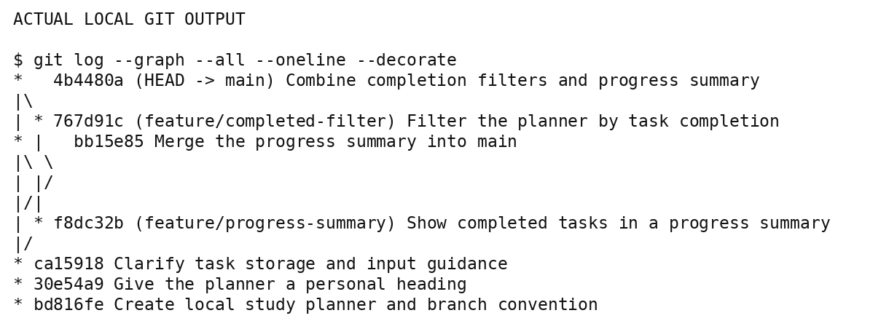
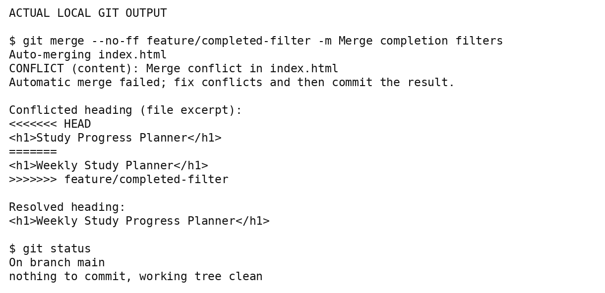

# Study Planner Git Practice

An original, AI-assisted learning project demonstrating focused commits,
feature branches, and merge conflict resolution.

## Open the planner

Choose **Code > Download ZIP**, extract it, and open **index.html** in a browser.
No server, AWS account, Docker installation, or package installation is needed.
The planner lets you add tasks with a course and priority, mark them complete,
remove them, see completion progress, and filter all, open, or completed tasks.
Tasks are saved in the same browser's local storage.

## What the Git exercise demonstrates

- Two unrelated edits in one file were staged separately with `git add -p`.
- The heading and help text were recorded in separate, focused commits.
- `feature/progress-summary` added a completion count.
- `feature/completed-filter` added completion filtering.
- Both branches changed the same heading, deliberately creating a real conflict.
- The first conflicted merge was aborted. The next attempt combined the heading
  wording while keeping both features, then committed the resolution.
- The completed local working tree was clean. Eight JavaScript logic checks
  also verified the two merged behaviors in a lightweight DOM harness.

The logic checks are not a browser layout test. Run the planner in your browser
to check its display and interactions yourself.

## Evidence and history

The **original local exercise has seven commits**, including two merge commits.
Its logs and figures are in [evidence](evidence), and its exact Git objects are
preserved in [original-history.bundle](history/original-history.bundle).

The seven exercise commits were replayed here using identical file snapshots,
commit messages, and merge-parent relationships. GitHub assigned new commit
IDs. This hosted copy also includes separate setup and publishing commits.
[commit-map.json](history/commit-map.json) maps the original IDs in the figures
to their GitHub counterparts. Both practice feature branches remain available.

To inspect the exact original history after downloading the bundle:

```bash
git clone original-history.bundle original-practice
cd original-practice
git log --graph --all --oneline --decorate
```





## Repeat the exercise

Follow [PRACTICE.md](PRACTICE.md) to inspect the focused commits and reproduce
the conflict on a new branch. These steps preserve the finished main branch.
Optional logic checks can be run with Node.js and no additional packages:

```bash
node verify_logic.cjs
```

## Learning source and assistance

The source tutorial is Tobias Günther's [Git for Professionals Tutorial](https://youtu.be/Uszj_k0DGsg)
on freeCodeCamp. The original application, guided Git operations, and publishing
were completed with ChatGPT assistance. The local practice commits use a
generic exercise identity. Publishing commits reflect the authorized GitHub
connection. No independent student execution, teammate review, or pull request
approval is claimed by these logs.
